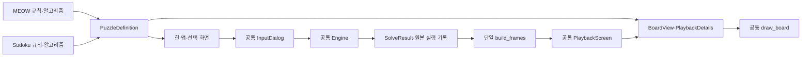

# 하나의 앱과 두 퍼즐 정의

입력기·재생기·보드 렌더러·실행 흐름·웹 번들은 각각 하나다.
앱의 선택 화면에서 MEOW Queens와 Sudoku를 바꾸며, 퍼즐별 초안은 따로 보존한다.
퍼즐 패키지에는 화면 클래스, pygame 이벤트 처리와 그리기 코드가 없다.

## 퍼즐 정의

`meow/definition.py`, `sudoku/definition.py`는 `PuzzleDefinition` 하나를 제공한다.
제목·기호·빈칸·크기 범위·프리셋·전사 프롬프트는 등록 데이터다.
`normalize`, `parse`, `create`, `solve`, `grid`는 실제 퍼즐 의미를 처리한다.
`editor_view`와 `frame_view`는 초안/원본 단계에서 표시 데이터를 만들고,
`describe`는 단계 설명을 제공한다. `validate_frames`는 창 생성 전에
외래 퍼즐의 상태·추론·가정과 잘못된 payload를 거부한다.

공통 입력기·재생기·렌더러는 퍼즐 이름으로 분기하지 않는다.
두 정의를 import하는 곳은 앱 조립 지점인 `puzzle_common/app.py`다.
별도 화면을 등록하는 factory, 런타임 플러그인 검색과 추가 의존성은 없다.

## 같은 입력·표시·재생

`InputDialog`는 불변 정규화 격자를 편집한다. 모든 퍼즐은 방향키/Tab 이동,
기호 입력, Delete/Backspace/0 삭제, 채운 칸에서 드래그, 같은 프리셋/JSON/
프롬프트 조작을 사용한다. 가변 크기 조작은 정의의 크기 범위에 따라 제공한다.
잘못된 JSON과 크기는 현재 초안을 보존하며 모달이 열려 있으면 배경 편집을 막는다.
MEOW의 미완성 영역과 Sudoku의 중복 숫자는 정의가 각각 해석한다.

`BoardView`는 원본 source와 같은 크기의 영역 격자·CellView 격자다.
CellView는 배경, 글자/고양이/X, 후보 위치/취소선, 강조와 테두리를 제공한다.
`puzzle_common/board.py`만 이 데이터를 그린다. 숫자 박스와 불규칙 영역 경계도
인접한 영역 값 비교로 그린다. 작은 보드는 맞는 글꼴을 고른 뒤 긴 라벨을 자른다.

`PlaybackScreen`은 `build_frames(result)`를 한 번 호출하고 원본 프레임을 유지한다.
현재 프레임만 BoardView/PlaybackDetails로 투영하며 별도 타임라인을 만들지 않는다.
렌더링 전 표시의 source가 현재 snapshot 자체이고 보드 크기가 맞는지 검사한다.
초기 숫자/후보/제거 후보/근거/모순/활성 가정과 MEOW의 고양이·제외 칸을 표시한다.

단계 이동, 길게 누르기, 자동 재생, Home/End와 패널은 공통 코드 하나가 담당한다.
재생 Esc는 원본 편집으로, 편집 Esc는 선택 화면으로 돌아간다.
어떤 화면이든 같은 이벤트 묶음의 창 닫기가 우선하며 모달과 pygame을 정리한다.

## 풀이 코어의 보존

`EngineState`는 `clone`, `snapshot`, `find_contradiction`, `is_complete`를 제공한다.
각 domain은 추론/적용, 가정 순서, 가정/반증, MRV 후보와 해 동등성 규칙을 제공한다.
논리 고정점·한 단계 가정·반증 후 재추론·상한 DFS는 기존 Engine에서 한 번만 실행한다.
가정에는 clone을 쓰고 조용한 DFS는 화면 기록과 가정 순위 이력을 만들지 않는다.

MEOW는 고양이 배치 뒤 제외를 별도 추론으로 기록하고, Sudoku는 숫자 배치 때
이웃 후보를 갱신한다. 이 서로 다른 상태 변화의 의미는 각 퍼즐 코어에 남긴다.
MEOW의 독립 exact 판정과 대표 해 상한1, Sudoku의 서로 다른 해 상한2를 유지한다.
표시된 해가 하나라는 이유로 유일해를 추정하지 않는다.

`SolveResult(outcome, run)`과 LogicStep/LogicRun/ProbeRun/ProbeRound/SolveRun은
기존 계약이다. 앱과 화면은 같은 결과 객체를 받고 알고리즘 실행 기록을 재작성하지 않는다.
RESTORE/REFUTATION에는 결정값을 남기되 활성 가정으로 표시하지 않으며,
SEARCH와 해 없음은 버린 가정이 아닌 permanent root state를 사용한다.

## 실행과 배포

`python -m puzzle_common`과 `main.py`는 같은 선택 화면을 실행한다.
`python -m meow`, `python -m sudoku`는 같은 앱의 시작 모드만 지정한다.
`scripts/build_web.py`는 두 퍼즐과 공통 코드를 담은 APK 하나를 만든다.
기존 `/meow/`, `/sudoku/`는 같은 앱의 `?puzzle=` 시작 모드로 연결한다.

검사는 전체 Ruff/pytest와 단일 웹 빌드를 함께 실행한다. 원본 알고리즘/파서/
실행 기록 검사와 공통 화면의 실제 조작·외래 데이터 거부·초안 복귀 검사를 유지한다.
