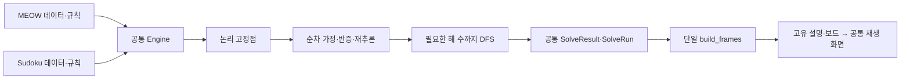

# 공통 구현과 퍼즐 어댑터

두 앱은 하나의 풀이 실행 엔진, 하나의 입력 화면과 하나의 풀이 재생 화면을 사용한다.
공통 모듈은 `meow`, `sudoku`를 import하지 않으며 앱 이름으로 분기하지 않는다.

| 공통 구현 | 책임 | 퍼즐별로 제공할 내용 |
| --- | --- | --- |
| `puzzle_common.engine.Engine` | 논리 고정점, 순차 한 단계 가정, 반증·재추론, 상한이 있는 조용한 DFS, 공통 실행 기록 | 같은 State 계약, 기법/적용/순위/이력/가정/반증/MRV/해 동등성 규칙 |
| `puzzle_common.app.run_app` | pygame 수명주기, 편집 → 풀이 → 재생 → 편집 반복, 해 없음의 편집 복귀, 종료 정리 | `PuzzlePlugin` 하나에 편집기/재생기, 정규화된 solve, 초안 추출 등록 |
| `puzzle_common.engine.SolveResult` | 검증된 Outcome과 원본 SolveRun을 화면까지 같은 객체로 전달 | MEOW 독립 exact 판정 또는 Sudoku 해2개 확인으로 분류 |
| `puzzle_common.presentation.build_frames` | 하나의 FrameKind/PlaybackFrame과 일정한 단계 생성 | 각 퍼즐의 describe_frame과 보드 렌더링 |
| `puzzle_common.layout` | 입력/재생 창·보드·패널의 배치, `cell_rect`/`cell_at` 셀 좌표와 히트 검사 | 실제 격자 크기 |
| `puzzle_common.constraints.locked_candidate_targets` | 후보가 한 단위에 모였을 때 원본 단위 밖에서 제거할 칸 선택 | 단위/후보/가능 칸 판정, 기법 순서, 최소 근거 수와 설명 |
| `puzzle_common.input_dialog.InputDialog` | 레이아웃, 버튼, 프리셋 조작, 메시지/사용법, JSON/프롬프트/클립보드, 모달 정리, 이벤트 루프 | 제목/설명/프롬프트, 보드 상태와 편집 규칙, 파서/검증, 보드 그리기 |
| `puzzle_common.playback.PlaybackScreen` | 현재 단계와 인덱스, 공통 결과 배지·셀 위치·좌표·패널·버튼, 이동/누르기 반복/자동 재생/포커스 해제, 이벤트 루프 | 전달받은 같은 단계의 보드 그리기와 `PlaybackDetails` 변환 |
| `puzzle_common.catalog.read_catalog` | 패키지 JSON 파일 읽기와 파일/JSON 오류 처리 | 프리셋 스키마 검증과 캐시 |
| `puzzle_common.json_input.decode_json` | 입력과 프리셋 JSON 디코딩, 구문/과도한 복잡도 오류 처리 | 실제 숫자/영역 JSON 스키마 검증과 앱별 오류 타입 |
| 그 외 `puzzle_common` | 폰트/색상/텍스트 줄바꿈/격자선, 좌표 이름, 버튼/패널, 클립보드, DOM textarea, 프레임 처리 | 실제로 다른 폰트 크기와 퍼즐 영역 경계 |

## 같은 실행 규칙

`EngineState` 계약은 `clone()`, `snapshot()`, `find_contradiction()`,
`is_complete()`이다. 각 퍼즐은 기존 상태와 불변 스냅샷을 이 계약으로 제공한다.
`EngineDomain`은 아래 여덟 동작을 제공한다.

| 동작 | 퍼즐이 결정하는 내용 |
| --- | --- |
| `find_deduction(snapshot)` | 기존 기법 우선순위에 따른 다음 추론 |
| `apply_deduction(state, deduction)` | 검증된 상태 변경과 후보 전파 |
| `probe_candidates(snapshot)` | 화면에 설명할 가정 후보의 순서 |
| `probe_stalled(decision)` | 해당 풀이의 정체 이력 갱신 |
| `assume(state, decision)` | 하나의 가정을 상태에 적용 |
| `refutation(decision, contradiction)` | 반증된 가정을 제외하는 추론 생성 |
| `search_candidates(snapshot)` | MRV 탐색 후보와 순서 |
| `solution_key(snapshot)` | 두 해가 같은지 판정할 값 |

`meow.engine_adapter.MeowDomain`, `sudoku.engine_adapter.SudokuDomain`에는
이 규칙과 고유 점수 계산만 있다. 고정점·가정 순회·반증 재시작·재귀 탐색은 엔진에서
한 번만 구현한다. 모순을 먼저 확인하고 기법을 검색한 뒤, 더 할 기법이 없을 때 완성을
확인한다. 가정 상태는 clone이며, 조용한 DFS는 화면 기록과 가정 순위 이력을 만들지 않는다.

실행 기록은 `LogicStep → LogicRun → ProbeRun/ProbeRound → SolveRun`으로 일정하다.
양쪽 솔버는 `SolveResult(outcome, run)`을 반환하고 앱과 재생 화면은 같은 객체를 받는다.
퍼즐별 옛 LogicResult/SolveStep과 결과 상태 enum, 다시 만드는 변환 함수는 없다.
MEOW의 독립 exact 검증은 유지하고 엔진에는 해 상한1을 전달한다. Sudoku는 상한2를
전달하며 가정에서 발견한 해를 첫 해로 보존한 채 중복 없이 두 번째 해를 확인한다.

앱별 `app.py`는 `PLUGIN = PuzzlePlugin(...)` 등록 데이터만 제공한다. 두 웹 진입점과
`python -m meow`, `python -m sudoku`는 모두 `run_app(PLUGIN)`을 실행한다.
공통 패키지는 퍼즐을 검색하거나 import하는 전역 레지스트리를 갖지 않는다.
새 퍼즐도 같은 상태/규칙 계약, 설명·보드 어댑터와 PLUGIN을 제공하면 같은 엔진을 사용한다.

## 입력 화면

`MeowInputDialog`, `SudokuInputDialog`는 공통 `InputDialog`를 상속한다.
앱별 `input_dialog.py`에는 숫자 또는 영역의 입력 규칙, JSON을 실제 초안으로
적용하는 로직, 보드 그리기만 둔다. MEOW의 크기 입력·영역 드래그와 Sudoku의
숫자 입력·중복 표시는 각각의 퍼즐 입력 규칙이다.

잘못된 JSON은 현재 보드와 입력문을 보존한다. 모달이 열려 있는 동안에는
뒤의 보드를 편집하지 않는다. 모달 생성·폴링·오류 표시·닫기와 예외 정리는
공통 화면이 담당한다.

첫 방향키와 Tab은 양쪽에서 첫 칸을 선택한다. Tab/Shift+Tab은 칸 순서로
이동하고 양 끝에서 멈춘다. Ctrl/Alt/GUI 조합은 편집·삭제·풀이 시작으로
전달하지 않으며 기존 Ctrl+V JSON 기능은 유지한다. MEOW 크기 필드는 먼저
키를 처리한다. A~Z 영역 입력과 Sudoku 단독 C/R/S 단축키는 고유 동작으로 유지한다.
같은 값을 다시 입력하면 기존 오류/안내를 유지한다.

## 풀이 재생

`MeowVisualizer`, `SudokuVisualizer`는 공통 `PlaybackScreen`을 상속하고 솔버가 반환한
`SolveResult`를 직접 받는다. 해 분류는 공통 `Outcome.UNIQUE/MULTIPLE/UNSOLVABLE`이다.
별도 PlaybackData/to_playback이나 MEOW 전용 timeline은 없다.

공통 화면이 `build_frames(result)`를 한 번 호출해 불변 `PlaybackFrame` tuple을 만든다.
프레임은 원본 snapshot/deduction/assumption/contradiction을 참조한다. 같은 현재 프레임이
`_draw_board(frame)`과 `_presentation(frame)`에 전달되고, 퍼즐별 `describe_frame(frame,result)`는
이 한 단계의 제목·사유·적용 내역·활성 가정·관련 색상만 `PlaybackDetails`로 설명한다.
퍼즐별 presenter는 실행 기록을 다시 순회하거나 단계 목록을 만들지 않는다.

단계 순서는 양쪽 모두 START → 추론 → LOGIC_END → 후보 선택 → 가정 시작/추론/종료 →
실패한 가정 복원 → 반증/재추론/LOGIC_END → 필요한 경우 SEARCH → FINAL이다.
Sudoku가 이전에 생략하던 선택/복원/종료와 MEOW 반증 후 종료 단계가 추가된다.
실제 추론·가정 순서와 기존 설명/픽셀은 유지한다. 프레임 수 변화는 탐색량 증가가 아니다.

RESTORE/REFUTATION은 가정의 결정값을 보존하되 `active_assumption`은 None이다.
Sudoku 반증은 빨간 강조만 유지하며 주황 숫자·테두리·활성 배지를 표시하지 않는다.
복원 단계에는 실패한 가정의 강조를 남기지 않는다. SEARCH와 해 없음의 FINAL은 버린
가정의 스냅샷이 아닌 `result.root_state`를 사용한다.

공통 화면은 창 구성 전에 `_validate_frames()`로 원본 스냅샷을 검사한다. 같은 프레임형을
사용하더라도 다른 퍼즐의 payload는 거부한다. MEOW는 모든 단계의 영역 소속, Sudoku는
원본 스냅샷 구조·데이터 타입과 초기 보드 소속을 확인한다.

해가 없으면 두 앱 모두 원본 초안을 보존해 편집 화면으로 복귀한다.
공통 메시지는 `현재 입력으로 가능한 해가 없습니다. 원본 문제와 입력을 확인하세요.`이다.
직접 생성한 해 없음 재생 데이터도 양쪽 재생기에서 확인할 수 있다.

고양이/X/색상 영역과 숫자/후보/근거 강조의 렌더링은 보드 어댑터에 남긴다.
이전/다음, Home/End, 키와 마우스 길게 누르기, 자동 재생, Esc 편집 복귀와
종료 처리는 공통 화면에서 한 번만 구현한다.

창은 양쪽 입력/재생 모두 1010×700, 보드 영역540, 패널350×560을 사용한다.
작은 안내 글꼴은 공통 `Fonts.info`15이며 실제 숫자/후보 크기는 각 퍼즐에 맞게 유지한다.

## 변경 기준

Sudoku의 pointing/claiming과 MEOW의 영역↔행/열 잠금은 같은 후보 고정 연산을 사용한다.
실제 배치/제외의 고유 연산은 퍼즐 어댑터가 제공하고, 실행과 공통 기록은 엔진이 담당한다.
MEOW의 모순 판정과 메시지는
`LogicSnapshot.contradiction_message()`가 담당한다. 버튼은 그릴 때 호버를 계산하며
입력/재생 화면이 별도의 호버 상태를 갱신하지 않는다.

버튼·패널·조작·메시지·입력창·앱 전환을 바꿀 때에는 공통 모듈을 수정한다.
추론 종료·가정 실행·반증 재시작·탐색 흐름을 바꿀 때에는 `puzzle_common.engine`을 수정한다.
퍼즐 규칙·기법 우선순위·JSON 형식·숫자 또는 영역의 의미를 바꿀 때에는 해당
퍼즐의 코드와 어댑터를 수정한다. 공통 모듈에서 앱 이름을 검사하는 방식으로
예외를 쌓지 않는다.

검사는 `uv run python -m pytest -q -W error`로 양쪽 앱과 공통 회귀 검사를
함께 실행한다. 웹 배포 전에는 `uv run --group web python scripts/build_web.py`로
두 번들을 함께 빌드한다.
